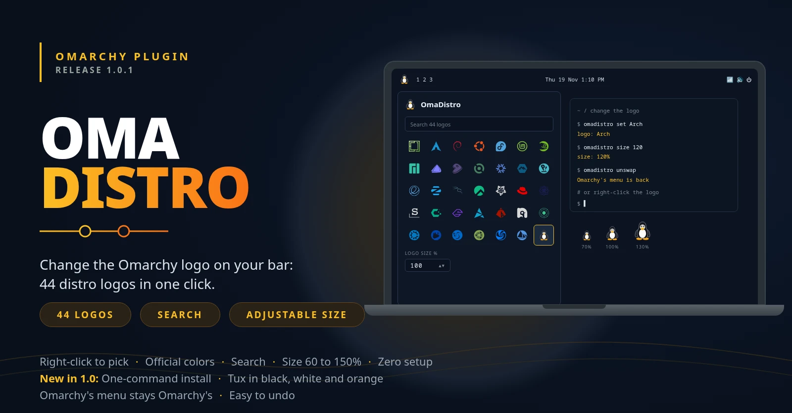

# OmaDistro: change the Omarchy logo on your bar



The icon at the top-left of Omarchy's bar is the menu button. OmaDistro lets you swap its
logo in one click: the Omarchy logo, the Arch Linux logo, or one of 42 other distro logos,
each in its official color, at the size you like. The menu itself stays Omarchy's own, so clicking it, scrolling on
it and its tooltip work as before. That is all this plugin does.

**Compatibility:** works with Omarchy 4.5 (checked on 4.5.0-3: manifest validation, the plugin's own tests, and every Omarchy component, command and bar interface it uses).

## What's new in 1.0.1

- Works with the menu or the logo in **any bar section** (left, centerBegin, center, centerEnd,
  right, tray) and with bare-string entries in the layout. 1.0.0 only looked in left, center
  and right.
- Safer `shell.json` edits: a symlinked file stays a symlink, every command is locked and
  re-checked just before the write, and `shell.json` with comments gets a clear message.
- Backups: the first file changed is kept as `shell.json.omadistro-original`, plus only the
  last 3 earlier versions (1.0.0 left one file per change, and two changes in one second
  overwrote each other).
- `unswap` moves the menu's own settings back from the `plugins` list.
- Logo license notes: URLs, "modified" notes and the license scope for the bundled drawings.
## Install

```bash
omarchy plugin add https://github.com/alshareedah22/omadistro --enable
```

Nothing else to do: when enabled, it turns the menu on your bar into the logo copy, in the
same place, with the Omarchy logo. No swap, no config.

## Change the logo

- **Right-click the logo** to open the picker: a grid of all 44 logos with a search box.
  Click one and the bar updates.
- Or from a terminal: `omadistro set Arch` (the script is in the plugin folder, and
  `omadistro list` prints every name).
- **Size**: the picker has a "Logo size %" box (60 to 150, 100 is Omarchy's full 16 px icon;
  the picker stays open while you adjust it). From a terminal: `omadistro size 120`.
- Or set `"logo": "Arch"` (and `"iconSize": 120`) on the plugin's entry in the bar layout of
  `~/.config/omarchy/shell.json`.
- Or open the picker from a keybinding. Add this to `~/.config/hypr/bindings.lua`:

```lua
o.bind("SUPER + CTRL + ALT + D", "Menu logo", "qs -p /usr/share/omarchy/shell ipc call omadistro togglePicker")
```

Right-click on the logo used to open a terminal in Omarchy; SUPER+RETURN still does.

## What it changes

On first enable it edits `~/.config/omarchy/shell.json` once: the `omarchy.menu` entry in the
bar layout becomes `{"id": "blackcode.omadistro", "logo": "Omarchy"}`, and the menu's own
settings (if any) move to the `plugins` list, where Omarchy keeps settings of a widget that is
not in the layout. Every write is atomic, follows a symlinked `shell.json` (dotfile managers keep working), is
locked against a second `omadistro`, and is re-checked just before it lands, so a save by Omarchy
at the same moment is not lost. The first file it ever changed is kept as
`shell.json.omadistro-original`, plus the last 3 earlier versions as `shell.json.omadistro-<time>`.
It works with the menu or the logo in any bar section (left, centerBegin, center, centerEnd,
right, tray). `shell.json` with comments is not supported.

## Remove

Put Omarchy's own menu back first, while the plugin is still installed:

```bash
python3 -I ~/.config/omarchy/plugins/blackcode.omadistro/omadistro unswap
omarchy plugin remove blackcode.omadistro
```

`unswap` turns the logo back into `omarchy.menu` in the same place, moves the menu's own settings back from the `plugins` list, and changes nothing else.

## Logos

Omarchy and Arch are drawn for this plugin family; the other distro logos come from Simple
Icons. They are trademarks of their projects, shown unaltered in their brand colors. Black
brand logos (AlmaLinux, Slackware, Nobara, MX Linux, SUSE) are drawn in the bar's text color so
they show on a dark bar. Sources and licenses: [`icons/LOGOS.md`](icons/LOGOS.md).

## Tests

```bash
python3 -I -m unittest discover -s tests
```

They run in a throwaway directory and never touch your shell.json.

## Files

| File | What it is |
|------|------------|
| `manifest.json` | Plugin id `blackcode.omadistro`, the `logo` and `iconSize` settings |
| `Panel.qml` | Hosts Omarchy's menu, hides its glyph and draws the logo at your size |
| `LogoPicker.qml` | The picker (grid and search) |
| `Service.qml` | Starts the first-run setup, the IPC to open the picker |
| `Logos.js` | The 44 logos |
| `omadistro` | Command-line tool: `setup`, `set`, `size`, `list`, `unswap` |
| `icons/` | The logo drawings |
| `poster/`, `preview.png` | Cover image |

MIT licensed.

## License

MIT, see [LICENSE](LICENSE), for the code. The logo drawings keep the licenses of their sources, listed in [`icons/LOGOS.md`](icons/LOGOS.md); the logos are trademarks of their projects and are shown to mark your bar, not to imply endorsement.
